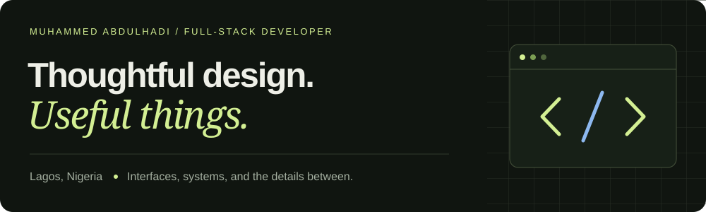
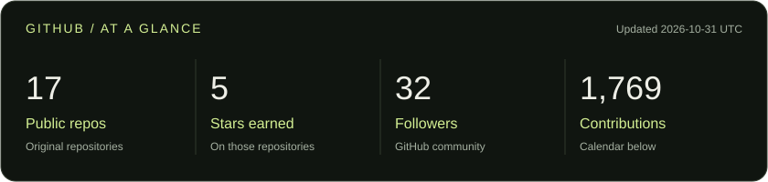

# Muhammed Abdulhadi

**Full-stack developer · Lagos, Nigeria**

I build thoughtful websites and practical web applications — from the interface people use to the systems that keep it running. My background in graphic design shapes how I approach clarity, usability, and the details.

Open to **junior full-stack roles** and **freelance collaborations** · Remote / Hybrid

[Portfolio](https://mrglasswillbreak.vercel.app) · [Résumé](https://mrglasswillbreak.vercel.app/resume) · [LinkedIn](https://www.linkedin.com/in/muhammed-abdulhadi-7b9ba2278) · [Email](mailto:mrglasswillbreak@gmail.com)

---

## GitHub in view

Refreshed daily from GitHub. Repository and language totals cover owned, public, non-fork repositories; language share measures code size, not proficiency. Contributions follow GitHub’s calendar and visibility rules. [How the graphics update](docs/profile-graphics.md).

---

## Selected work

### 01 / TurnRight

**Explore a campus. Build a better map.**

A multi-campus map and GIS platform for LASU Ojo and UNILAG Akoka. Visitors can explore a globe, inspect 3D buildings and photographs, plan walking or driving routes, and download verified offline campus packages. A private team editor brings together GIS imports, precision drawing, spatial analysis, building authoring, and independently reviewed releases.

**React · TypeScript · MapLibre · Three.js · Python · Supabase / PostGIS**

[Case study](https://mrglasswillbreak.vercel.app/projects/turnright) · [Live site](https://turnright.vercel.app/)

*Independent project, not an official university service. Routes and entrances still require field verification; modeled dimensions can be estimated or illustrative. No verified step-free guarantee. The editor case study uses local demonstrations; some source-import workflows require staged production enablement.*

### 02 / RJWF

**A digital home for care and community.**

A public website and redesigned Content Studio for RemmyJ Wellness Foundation. Guided page editing combines responsive previews, reusable sections, autosaved drafts, explicit publishing, and revision restore. A private inbox manages contact, partnership, beneficiary, and volunteer submissions with statuses, internal notes, and recoverable trash.

**React · Vite · PostgreSQL · Vercel Blob**

[Case study](https://mrglasswillbreak.vercel.app/projects/rjwf) · [Live site](https://remmyjwellnessfoundation.org)

### 03 / Photography Portfolio

**The work in focus. The tools behind it.**

An image-led photography website with a database-backed masonry gallery, category filtering, and a zoomable lightbox. Its private CMS manages uploads, alt text, services, and page copy, with live typography previews, replaceable favicons, editable login credentials, and first-party visitor analytics. Contact enquiries are delivered by email.

**Next.js · TypeScript · Tailwind CSS · PostgreSQL · Vercel Blob**

[Case study](https://mrglasswillbreak.vercel.app/projects/photography-portfolio) · [Live site](https://photography-portfolio-amber-nine.vercel.app) · [Source code](https://github.com/mrglasswillbreak/photographyPortfolio)

### 04 / Fidarsi

**A considered presence. A connected platform.**

A corporate website and registration platform for an African-founded proprietary trading firm. Public pages include a search-ready newsroom and accessible navigation. Trader and academy workflows combine email verification, role-based access, private document handling, and registration review; administrator access uses time-limited invitations.

**Next.js · TypeScript · PostgreSQL · Resend · Vercel Blob**

[Case study](https://mrglasswillbreak.vercel.app/projects/fidarsi) · [Live site](https://fidarsica.org)

### 05 / KinSous

**A taste of home. A helping hand nearby.**

A Nigeria-first culinary marketplace connecting food requests with local helpers. A searchable bounty board, bids, and private conversations lead into order milestones, verified NGN payment events, and operator review for payouts, refunds, and disputes. The installable PWA offers offline fallback and account-scoped draft recovery while keeping private APIs network-only.

**Next.js · TypeScript · Tailwind CSS · Neon PostgreSQL · Vercel Blob · Flutterwave**

[Case study](https://mrglasswillbreak.vercel.app/projects/kinsous) · [Live site](https://kinsous2.vercel.app) · [Source code](https://github.com/mrglasswillbreak/kinSous2)

*The hosted app requires sign-in; the screenshot uses local demo data. Payment workflows require provider configuration and approval for live collection and delayed payouts.*

---

## What I work with

- **Interfaces:** JavaScript, TypeScript, React, Next.js, HTML, CSS, Tailwind CSS
- **Application systems:** Node.js, Express, PostgreSQL, Supabase, REST APIs, authentication, content management
- **Maps and spatial tools:** MapLibre, Three.js, PostGIS, Python GIS processing, offline map packages
- **Delivery:** Git, GitHub, Vercel, responsive design, accessibility, and search visibility

Currently deepening my full-stack skills through independent projects and The Odin Project.

## Let’s build something useful

Have a project, a role, or an idea to discuss? Reach me at **[mrglasswillbreak@gmail.com](mailto:mrglasswillbreak@gmail.com)**.

[Explore my portfolio](https://mrglasswillbreak.vercel.app) · [Connect on LinkedIn](https://www.linkedin.com/in/muhammed-abdulhadi-7b9ba2278)
